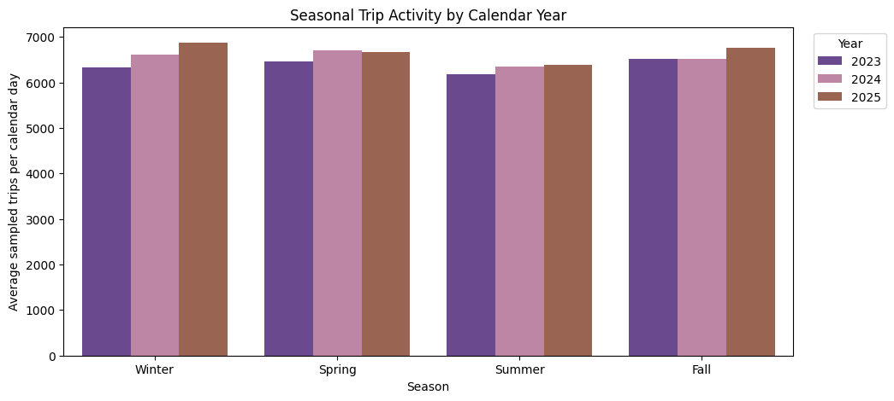
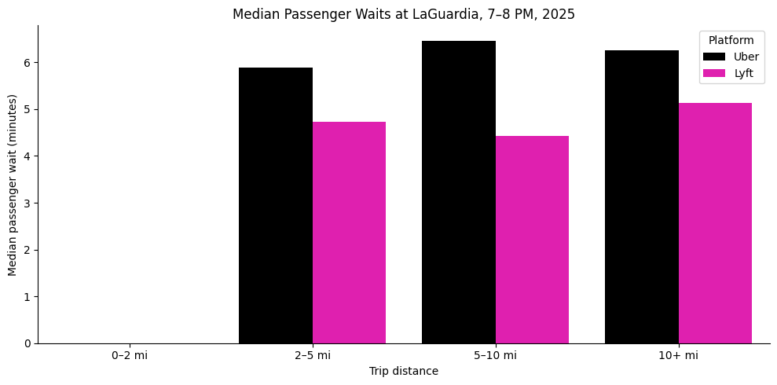

# NYC Rideshare Demand Analysis | 2023–2025

## Project Overview

How do seasonality, time of day, location, and weather influence rideshare demand in New York City?

This project analyzes over **7.1 million Uber and Lyft trips from 2023 to 2025** to identify patterns in rideshare demand, passenger wait times, and driver compensation.

The goal was to understand when and where rideshare activity is highest and translate these findings into recommendations for improving Uber's driver availability, operational efficiency, and customer experience.

## Tools & Technologies

- **Python:** pandas, NumPy, Matplotlib, Seaborn
- **Data Cleaning:** Handling missing values, removing duplicates, validating timestamps, and preparing datasets
- **Data Analysis:** Exploratory data analysis, aggregation, trend analysis, and competitive comparisons
- **Data Visualization:** Line charts, heatmaps, boxplots, and comparative visualizations
- **Business Analytics:** Identifying operational challenges and developing data-driven recommendations

## Key Findings & Visualizations

### 1. Seasonal Demand Patterns

Rideshare activity varied across seasons, with winter demand increasing steadily from 2023 to 2025. Summer generally experienced lower trip activity compared with other seasons.

These patterns highlight the importance of anticipating seasonal changes when planning driver availability.

### 2. Peak Demand by Day & Hour

Friday and Saturday evenings experienced particularly high rideshare activity, while passenger wait times peaked around 4 AM in 2025.

Understanding these patterns could help rideshare platforms better align driver availability with passenger demand.

### 3. Uber vs. Lyft: Passenger Wait Times

At LaGuardia Airport, Uber's median passenger wait time was approximately two minutes longer than Lyft's for trips between 5 and 10 miles during the 7–8 PM period.

This comparison identifies a potential opportunity for Uber to improve airport pickup coordination and reduce passenger wait times.

### 4. Weather & Rideshare Activity

Analysis of daily weather conditions found relatively small overall differences in passenger wait times and base fares between dry days and days with precipitation.

This suggests that weather should be considered alongside other factors when evaluating changes in rideshare activity.

## Business Recommendations

Based on the findings, three potential opportunities were identified:

1. **Optimize Early-Morning Driver Availability:** Review driver coverage during hours associated with longer passenger wait times.
2. **Improve Airport Pickup Coordination:** Investigate operational improvements at LaGuardia Airport, where Uber experienced longer median waits than Lyft.
3. **Use Demand Patterns for Planning:** Incorporate seasonal and hourly trends into driver availability planning to better anticipate fluctuations in passenger demand.

## Data & Methodology

The analysis used a 1% monthly random sample of NYC high-volume for-hire vehicle trip records from January 2023 through December 2025.

**Data Sources:**
- NYC Taxi & Limousine Commission (TLC) Trip Record Data
- NYC TLC Taxi Zone Lookup Table
- NOAA Daily Weather Data (LaGuardia Airport)

**Analytical Process:**

1. Combined 36 months of sampled rideshare records.
2. Cleaned and validated over 7.1 million observations.
3. Integrated geographic information and daily weather data.
4. Analyzed demand across seasons, days, hours, and pickup locations.
5. Compared Uber and Lyft performance using passenger wait times and other trip metrics.
6. Translated analytical findings into business recommendations.

**Final Dataset:** 7,155,498 rideshare trips.

## View the Full Analysis

The complete Jupyter notebook, including Python code, data preparation, visualizations, and detailed findings, is available in this repository:

`B06_NYC_Rideshare_Seasonal_Demand_Patterns.ipynb`

## Project Team

**Team Members:** Elizabeth Lukina, Sally Hao, Taaseen Islam, Teddy Tessel, and Melis Gurbuz.
